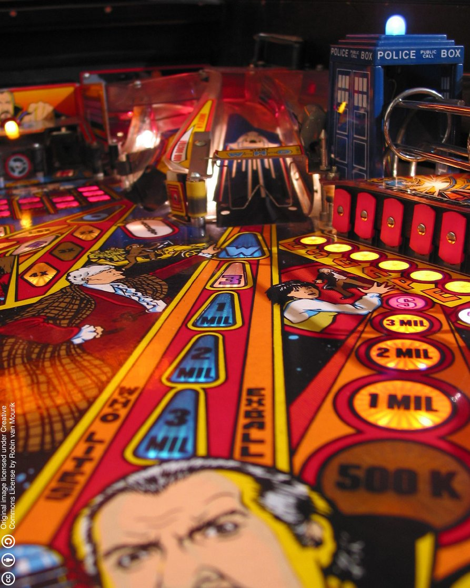

# WebAR-Canvas

<p align="center">
  
</p>

<p align="center">
  <strong>High-performance, pure C++ Augmented Reality framework for the Web</strong><br />
  Powered by <strong>WebARKitLib</strong> (Natural Feature Tracking), rendering with <strong>Google Filament</strong> (PBR, the default) or <strong>sokol_gfx</strong> (a lighter alternative).
</p>

<p align="center">
  <a href="https://github.com/kalwalt/WebAR-Canvas/actions/workflows/build.yml"></a>
  <a href="https://en.cppreference.com/w/cpp/17"></a>
  <a href="https://webassembly.org/"></a>
  <a href="https://emscripten.org/"></a>
  <a href="https://github.com/google/filament"></a>
  <a href="https://github.com/floooh/sokol"></a>
  <a href="https://www.khronos.org/webgl/"></a>
  <a href="https://www.gnu.org/licenses/lgpl-3.0"></a>
  <a href="https://github.com/kalwalt/WebAR-Canvas/pulls"></a>
</p>

---

## 🌟 Overview

**WebAR-Canvas** is a "C++ first" Augmented Reality engine compiled directly to WebAssembly. Unlike traditional web AR solutions where computer vision tracking runs in WASM while rendering runs across a JavaScript bridge (e.g. Three.js / Babylon.js), **WebAR-Canvas executes the entire tracking, matrix mathematics, scene graph, and rendering pipeline inside native C++**.

By running Google Filament and WebARKitLib side-by-side in native code, WebAR-Canvas eliminates bridge serialization overhead, minimizes garbage collection pauses, and delivers high-performance 6-DOF tracking with Physically Based Rendering (PBR).

---

## 🚀 Key Features

- **Pure C++ Architecture**: Zero Embind overhead inside the engine core. Matrices, tracking states, and application lifecycle are handled directly in native C++.
- **Google Filament WebGL 2**: Modern Physically Based Rendering (PBR) engine managing camera projection, lights, materials, and scene graph.
- **Two rendering backends**: Google Filament (the default: PBR, glTF models) or [sokol_gfx](https://github.com/floooh/sokol) (`--renderer sokol`: a lighter build that needs neither the Filament submodule nor its host tools). The tracking, the main loop and the backend-neutral mesh API are the same on both.
- **Natural Feature Tracking (NFT)**: Native integration of WebARKitLib (AR, AR2, KPM / FreakMatcher), supporting planar image markers without QR codes or black borders.
- **Dual Video Pipeline**:
  - **GPU Path**: Streams webcam frames directly to a WebGL texture rendered on an unlit full-screen quad in normalized device coordinates (`vertexDomain: device`).
  - **CPU Path**: Fast RGBA frame capture and persistent grayscale luminance conversion (`WebARKitVideoLuma`) for point matching and template tracking.
  - Where the browser supports `requestVideoFrameCallback`, both paths run once per new camera frame, not on every display frame.
- **Precise Coordinate Alignment**: ARToolKit calibration intrinsics (`camera_para.dat`) compute an exact right-handed OpenGL frustum (`arglCameraFrustumRH`) hooked directly into Filament's `camera->setCustomProjection()`, aligned with marker poses converted via `arglCameraViewRH`.
- **Responsive 1:1 Viewport**: Auto-resizing WebGL drawing buffer and CSS `object-fit: contain` preserve exact 4:3 camera proportions across any screen size.
- **Cross-Platform Toolchain**: Containerized compilation using Docker (`build-docker.js`) for seamless builds on Windows, Linux, and macOS.

---

## 🏛 Architecture

```
                  ┌───────────────────────────────────────────────┐
                  │              HTML5 <video> Stream             │
                  └───────────────┬───────────────────────────────┘
                                  │
                  ┌───────────────┴───────────────┐
                  ▼                               ▼
       [ GPU Rendering Path ]           [ CPU Tracking Path ]
    update_webgl_texture()           capture_video_frame()
                  │                               │
                  ▼                               ▼
        Native WebGL Texture            RGBA Frame Buffer
                  │                               │
                  ▼                               ▼
    Filament External Texture        WebARKitVideoLuma (Grayscale)
                  │                               │
                  ▼                               ▼
    Fullscreen Background Quad       KPM Point Feature Recognition
       (vertexDomain: device)                     │
                  │                               ▼
                  │                  AR2 Surface Template Tracking
                  │                               │
                  │                               ▼
                  │                  arFilterTransMat (Low-Pass Filter)
                  │                               │
                  ▼                               ▼
            Filament Scene  ◄───────────  modelViewMatrix (Pose)
                  │
                  ▼
         Renderer::render()
```

---

## 📁 Directory Structure

```
WebAR-Canvas/
├── assets/                     # Runtime assets embedded in the .wasm, and the printable marker
│   ├── camera_para.dat         # Camera intrinsic calibration file
│   ├── pinball.fset            # AR2 multi-resolution surface template dataset
│   ├── pinball.fset3           # KPM FREAK point feature descriptor dataset
│   ├── pinball.iset            # Compressed multi-scale image pyramid dataset
│   └── pinball.jpg             # Printable reference marker (not embedded; source of the pinball.* dataset)
├── materials/                  # Filament source shaders (.mat)
│   ├── video_background.mat    # Fullscreen device-domain video quad shader
│   └── ar_cube.mat             # Unlit vertex-colored 3D entity shader
├── src/                        # Native C++ source code
│   ├── core/                   # Engine (main loop, tracking), IARRenderer and its backends (FilamentRenderer, SokolRenderer)
│   ├── app/App.h/.cpp          # The application: the 3D AR scene (a cube on the marker)
│   ├── main.cpp                # Entry point
│   ├── shell.html              # Emscripten HTML shell template
│   └── nft/                    # Native C++ NFT tracking subsystem
│       └── ARNFTTracker.h/.cpp # NFT tracker: adapter over WebARKitLib's ARToolKitNFTCore
├── third_party/
│   ├── filament/               # Google Filament submodule (the Filament renderer only)
│   ├── sokol/                  # sokol_gfx.h + sokol_log.h, vendored (the sokol renderer; see its README)
│   └── WebARKitLib/            # WebARKitLib submodule (AR, AR2, ARICP, KPM, WebARKitNFT helpers)
├── build-wasm/                 # Compiled output directory (HTML, JS, WASM)
├── build-docker.js             # Cross-platform Node.js build runner for Docker
├── CMakeLists.txt              # CMake build definition
└── AGENTS.md                   # Canonical development rules & instructions
```

---

## ⚙️ Prerequisites & Setup

### 1. Clone Repository & Submodules
```bash
git clone --recursive https://github.com/kalwalt/WebAR-Canvas.git
cd WebAR-Canvas
```

If you previously cloned without `--recursive`:
```bash
git submodule update --init --recursive
```

**Windows: check out Filament with LF line endings.** Git for Windows defaults to `core.autocrlf=true`, which gives Filament's shell scripts CRLF line endings; they run in the Linux container and the host tools build fails with `/usr/bin/env: 'bash\r'`. Clone without `--recursive`, then check out the submodules with LF and keep LF for Filament:
```bash
git clone https://github.com/kalwalt/WebAR-Canvas.git
cd WebAR-Canvas
git -c core.autocrlf=false submodule update --init --recursive
git -C third_party/filament config core.autocrlf false
```
If Filament is already checked out with CRLF, switch it to LF (this discards local changes inside the submodule):
```bash
git -C third_party/filament config core.autocrlf false
git -C third_party/filament rm -q --cached -r .
git -C third_party/filament reset -q --hard
```
Both only change the submodule's own config, not your global one. Without them, `scripts/build-host-tools.sh` still converts `build/linux/combine-static-libs.sh` to LF so the build works, but the submodule then shows as modified in `git status`.

### 2. Docker & Node.js
Building WebAR-Canvas requires:
- **Docker Desktop** (or Docker engine on Linux).
- **Node.js** (v16+).

---

## 🔨 Building the Project

The WebAssembly build environment is containerized in `emscripten/emsdk:4.0.17`. Use the included cross-platform build runner:

```bash
# Standard incremental build
node build-docker.js

# Parallel compilation with custom job count (e.g. 8 jobs)
node build-docker.js -j 8

# Full clean rebuild
node build-docker.js --clean

# Build, then run the NFT tracker tests with Node (no browser or webcam needed)
node build-docker.js --test

# The sokol renderer instead of Filament: no Filament submodule, no host tools
node build-docker.js --renderer sokol --test

# A development build with debug information (-g), for readable stack traces
node build-docker.js --debug
```

**Published and development builds.** By default `build-docker.js` makes the published build, the one CI tests and GitHub Pages deploys: no debug information. `--debug` links the app with `-g` (`WEBAR_DEBUG_INFO=ON` in CMake) into the same build folder: C++ function names in the browser's stack traces, but a download several times larger, so never publish it. Switching between the two relinks the app; it does not recompile it.

**Rendering backend.** `WEBAR_RENDERER` (CMake) chooses the renderer: `filament` (default) or `sokol`. `node build-docker.js --renderer sokol` builds it into its own folder, `build-wasm-sokol/` (the same `videoTest.*` files), skips the Filament host tools and does not need `third_party/filament` checked out: sokol is two headers vendored in `third_party/sokol/`. glTF loading needs Filament's `gltfio`, so it is off with sokol. `--dry-run` prints the commands the container would run, without starting Docker. Sizes of the published `videoTest.wasm` at the time of writing: about 3.4 MB with Filament (1.8 MB gzipped) and 1.3 MB with sokol (0.8 MB gzipped); with `--debug`, 8.7 MB (2.9 MB) and 4.5 MB (1.7 MB).

The first build also compiles the Filament host tools (`matc`, `resgen`, `cmgen`, `glslminifier`, `uberz`) into `third_party/filament/out/host` with `scripts/build-host-tools.sh`; this takes a while once and is skipped afterwards. The same scripts run in CI (`.github/workflows/build.yml`) on every pull request to `dev` and `master`.

Before starting Docker, `build-docker.js` checks that it runs from the repository root with the submodules it needs checked out (both for Filament; only WebARKitLib for sokol) and that the Docker daemon answers; otherwise it stops at once and says what to do.

### Build Artifacts
Upon completion, the following artifacts are generated in `build-wasm/` (`build-wasm-sokol/` with `--renderer sokol`):
- `videoTest.html`: The ready-to-run HTML shell.
- `videoTest.js`: Emscripten JavaScript runtime glue.
- `videoTest.wasm`: The compiled native C++ engine binary.
- `videoTest.kpm.js`, `videoTest.kpm.wasm`: The KPM worker: marker detection runs in a Web Worker, off the main thread (#16). Deploy them next to `videoTest.js`; without them the app still works and detects on the main thread (slower while searching for a marker). `-DWEBAR_KPM_WORKER=OFF` builds the app without the worker.

---

## 🖥 Running & Testing

Due to browser security policies regarding webcam access (`getUserMedia`) and WebAssembly modules, files must be served over HTTP/HTTPS:

### 1. Start Local HTTP Server
```bash
python -m http.server 8000 --directory build-wasm
```
*(or use Node `npx serve build-wasm`)*

### 2. Open in Browser
Open `http://localhost:8000/videoTest.html` in Chrome, Edge, or Firefox.

### 3. Test with the Pinball Marker
1. Display or print the reference marker image located at [`assets/pinball.jpg`](assets/pinball.jpg) (WebARKitLib's `tests/pinball.jpg`, the image the `pinball.*` dataset was generated from, resized to the dataset's 893 × 1117 pixels at 120 dpi). Printed at its own 120 dpi it is 189 × 236 mm, the size the dataset expects, so poses come out in true millimetres.
2. Point your camera at the marker.
3. When recognized:
   - Console logs will report: `>>> NFT Marker 0 found <<<`.
   - An 80mm multi-colored 3D cube will appear anchored to the center of the marker, standing on the paper and spinning in real-time AR.

---

## 🎨 Developing Your Own AR Application

An app derives from `ARBaseApp` and overrides the hooks it needs; the demo is `src/app/App.h/.cpp`, and the same source builds with both renderers:

```cpp
#include "core/ARBaseApp.h"

class MyApp : public ARBaseApp {
protected:
    void setup() override {
        // Once, when the renderer and the tracker are ready: create your meshes.
        // The mesh API works with every renderer: unlit, vertex-coloured primitives in mm.
        const float red[4] = {1, 0, 0, 1};
        cube = addCube(80.0f, red);  // also addBox, addPlane, addSphere; an id, or -1
        attachMeshToMarker(cube, 0); // on marker 0, centred, hidden while it is lost
    }

    void update(float deltaTime) override {
        // Every frame: marker 0's pose is getModelViewMatrix() while getIsTracking() is true;
        // getMarkerPose(i, matrix) gives any marker's pose.
        // setMeshLocalTransform(cube, m) moves the cube relative to its marker.
    }

    void draw() override {
        // Every frame, after update() and before the frame is rendered.
    }

    void onMarkerFound(int markerIndex) override { /* a marker became tracked */ }
    void onMarkerLost(int markerIndex) override { /* a marker is no longer tracked */ }

    // Input, in canvas pixels (e.g. 0..640 x 0..480); pointerId tells touches apart.
    void touchDown(float x, float y, int pointerId) override { setMeshVisible(cube, false); }
    void mouseDown(float x, float y, int button, int pointerId) override { }

private:
    int cube = -1;
};

AR_APP_MAIN(MyApp, 640, 480, "/assets/markers/pinball")
```

The mesh API covers what the demo needs and no more: no materials, textures or lighting. For those, a Filament app (the default renderer) also has the Filament-only API: `getEngine()` / `getScene()` / `getCamera()`, `createBox` / `createCube` / `createPlane` / `createSphere` returning Filament entities, `attachToMarker(entity, i)`, and glTF models with `loadModel(path)` and `placeModelOnMarker(handle, i, sizeMm)`. With sokol, the glTF calls report failure:

| Call (sokol build) | Returns |
|---|---|
| `loadModel(path)` | -3 (`AR_MODEL_UNSUPPORTED`) |
| `webar_load_model(path)` (page, `Module.ccall`) | -3 (`AR_MODEL_UNSUPPORTED`) |
| `webar_place_model(handle, marker, sizeMm)` (page) | 0 (failure) |

`AR_APP_MAIN` only fills an `ARAppConfig` (canvas selector, camera frame size, camera parameter file, marker paths) and calls `runApp()`. You can fill the struct in code instead, and the page can override it at runtime by setting `Module.webarConfig` before the module starts, for example:

```js
var Module = { webarConfig: { markers: ['/assets/markers/pinball'], videoWidth: 640, videoHeight: 480 } };
```

The default shell (`src/shell.html`) already declares `var Module = { ... }`: add `webarConfig` to that object rather than declaring a second `Module`.

Two `webarConfig` fields concern the KPM worker: `kpmWorker: false` runs marker detection on the main thread instead (the default shell sets it for `?kpmWorker=0` in the page URL, for comparisons), and `kpmWorkerUrl` sets where `videoTest.kpm.js` is loaded from (default: next to `videoTest.js`).

To start your own project from this repository and publish it on GitHub Pages, see [Using WebAR-Canvas as a template](docs/template.md).

---

## 🌿 Git & Contribution Guidelines

- **Branching Strategy**:
  - **Every new branch must branch off `dev`**, never `master`.
  - **Every pull request must target `dev`**.
  - `master` is strictly reserved for tagged, stable releases.
- **Releases**: versions follow [Semantic Versioning](https://semver.org/) and are set by `project(VERSION)` in `CMakeLists.txt`; see [CHANGELOG.md](CHANGELOG.md).
- **Commit Messages**: Follow [Conventional Commits](https://www.conventionalcommits.org/):
  ```
  <type>(<scope>): <short summary>

  - Detailed bullet point 1
  - Detailed bullet point 2
  ```
  Allowed types: `feat`, `fix`, `perf`, `doc`, `refactor`, `test`, `style`, `chore`.

---

## 📄 License

This project is licensed under the **GNU Lesser General Public License v3.0** (LGPL-3.0) with a static-linking exception — see the [LICENSE](LICENSE) file for details.

### Third-Party Licenses & Acknowledgements
- **[Google Filament](https://github.com/google/filament)**: Apache 2.0 License.
- **[sokol](https://github.com/floooh/sokol)** (`sokol_gfx.h`, `sokol_log.h`, vendored in `third_party/sokol/`): zlib/libpng License.
- **[WebARKitLib](https://github.com/webarkit/WebARKitLib)** / **[jsartoolkitNFT](https://github.com/webarkit/jsartoolkitNFT)**: LGPL-3.0 / GPL-3.0 License.
- **[ARToolKit](https://github.com/artoolkitx/artoolkit5)**: GPL-3.0 License.